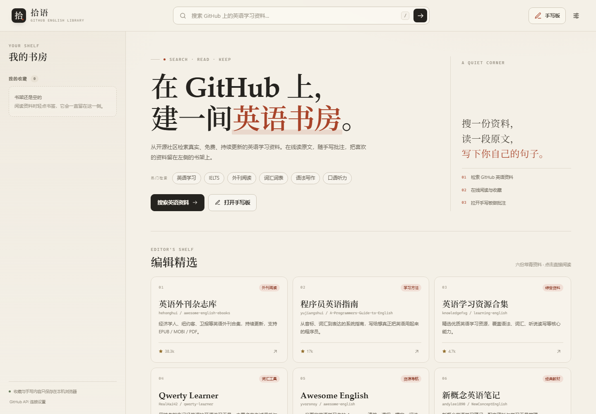
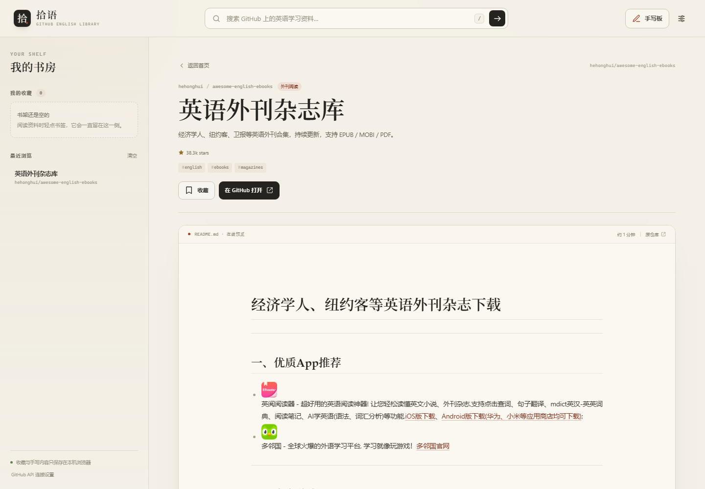
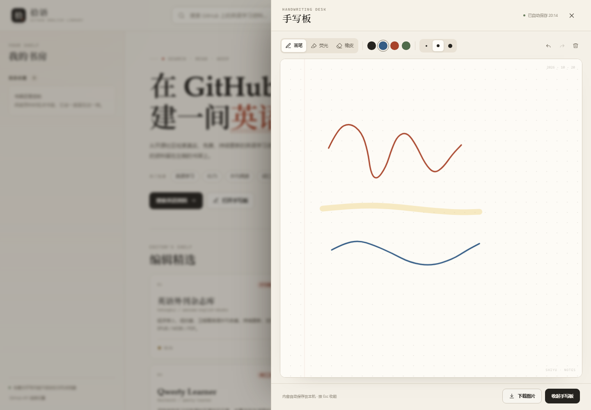

# 拾语 · GitHub 英语资料馆

**在 GitHub 上，建一间英语书房。**

拾语是一个单文件网页：检索 GitHub 上的英语学习资料，在线预览 README，把喜欢的仓库留在侧边栏，并用内置手写板记下批注。无需安装、无需后端、无需构建，双击 `index.html` 即可使用。

`单文件` · `零依赖` · `本地存储` · `MIT License`



## 功能

- **GitHub 仓库搜索**：按 Star 排序，每次展示 18 条结果，并提供 `topic:english-learning`、IELTS、外刊、词汇、语法、口语等快捷检索。
- **README 在线预览**：通过 GitHub API 读取并渲染 README，自动重写相对图片和链接。
- **我的书架**：收藏与最近浏览自动保存到本机，刷新页面后仍然保留。
- **手写板**：画笔、荧光笔、橡皮，4 种颜色、3 档粗细，支持撤销 / 重做 / 清空、自动保存和导出 PNG。
- **编辑精选**：内置 6 个常用英语学习仓库，打开首页即可直接阅读。
- **可选 API Token**：填写 GitHub Token 可提升接口额度；Token 只保存在浏览器本地。
- **响应式布局**：适配桌面、平板与手机。

### README 在线预览



### 手写板



## 快速开始

### 方式一：直接打开

下载或克隆仓库，双击 `index.html`。

页面本身不依赖服务器；搜索和 README 预览需要联网访问 GitHub API。

### 方式二：本地静态服务器（可选）

```bash
python -m http.server 8000
```

然后访问 <http://localhost:8000>。

### 方式三：部署到 GitHub Pages

1. 将本项目推送到 GitHub 仓库。
2. 打开仓库的 `Settings → Pages`。
3. 在 `Build and deployment` 中选择 `Deploy from a branch`。
4. 分支选择 `main`，目录选择 `/ (root)`，保存。
5. 稍等片刻，访问 `https://<你的用户名>.github.io/<仓库名>/`。

`index.html` 位于仓库根目录，因此不需要额外配置。

## 使用说明

1. 在顶部输入关键词，或点击首页的热门检索标签。
2. 点击搜索结果或精选卡片，进入 README 预览。
3. 点击书签按钮收藏资料；收藏和最近浏览会显示在左侧书架中。
4. 点击右上角「手写板」开始书写，内容会自动保存到本机。
5. 在手写板底部可以下载 PNG，或点击「收起手写板」返回阅读。

键盘快捷键：

| 快捷键 | 作用 |
| --- | --- |
| `/` 或 `Ctrl/Cmd + K` | 聚焦搜索框 |
| `Esc` | 关闭手写板 / 设置面板 / 移动端书架 |
| `Ctrl/Cmd + Z` | 手写板撤销 |
| `Ctrl/Cmd + Shift + Z` | 手写板重做 |

## GitHub API 与限额

项目直接调用 GitHub 公共 REST API，不需要自建服务。

| 场景 | 未填写 Token | 填写 Token |
| --- | --- | --- |
| 仓库搜索 | 约 10 次 / 分钟 | 约 30 次 / 分钟 |
| README 等核心接口 | 约 60 次 / 小时 | 约 5,000 次 / 小时 |

限额由 GitHub 控制，可能随时调整，以 [GitHub 官方文档](https://docs.github.com/rest/overview/rate-limits-for-the-rest-api) 为准。

在页面左下角点击「GitHub API 连接设置」可以填入个人访问令牌。Token：

- 只保存在当前浏览器的 `localStorage` 中；
- 只会随请求发送给 `api.github.com`；
- 不会写入源码，也不会上传到本项目的任何服务器（项目本身没有服务器）。

## 隐私

- 收藏、最近浏览、手写笔记和 Token 均保存在浏览器本地。
- 项目没有统计脚本、广告或自建后端。
- 在线预览 README 时会请求 GitHub API，以及 README 中引用的第三方图片和链接，这些请求受相应服务的隐私政策约束。
- 清除浏览器站点数据会同时清除收藏、浏览记录和手写内容。

## 技术实现

- 原生 HTML / CSS / JavaScript，无框架、无构建步骤、无第三方前端依赖。
- GitHub REST API：仓库搜索与 README 渲染。
- `localStorage`：收藏、最近浏览、手写内容与可选 Token。
- Canvas 2D + Pointer Events：鼠标、触控与手写笔输入。
- 单文件结构：全部样式与脚本内联在 `index.html` 中。

## 项目结构

```text
.
├─ index.html                 # 单文件应用
├─ README.md
├─ LICENSE
├─ .gitignore
└─ docs/
   ├─ screenshot-home.png
   ├─ screenshot-preview.png
   └─ screenshot-notebook.png
```

## 自定义

主要配置都集中在 `index.html` 中：

- `CURATED_RAW`：首页的编辑精选仓库。
- `QUICK_SEARCHES`：热门检索与快捷标签。
- `:root`：纸色、墨色、朱砂色等主题变量。
- `STORAGE`：本地存储键名。
- `API_ROOT`：GitHub API 地址。

修改后直接刷新页面即可看到效果，不需要构建。

## 参与贡献

欢迎提交 Issue 或 Pull Request。这个项目希望保持简单，提交前请尽量遵循：

- 不引入框架、构建工具或运行时依赖；
- 保持单文件可直接打开；
- 在桌面和移动端自测搜索、预览、收藏和手写板流程。

## License

[MIT](LICENSE) © 2026 Shiyu contributors

## 说明

本项目与 GitHub 官方无关联。仓库中的 README、图片及其他内容版权归各自原作者所有；拾语仅提供检索与阅读界面，不在仓库中重新分发这些内容。
